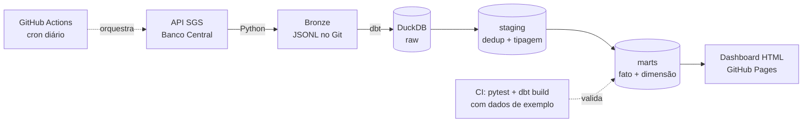

# Monitor de indicadores econômicos do Brasil

Pipeline de dados que coleta **todo dia útil**, de forma automática, o dólar, a Selic e o IPCA da API do Banco Central, modela os dados com dbt e DuckDB, valida a qualidade e publica um dashboard atualizado. Roda 100% de graça, sem nuvem paga.

**Dashboard:** `https://SEU-USUARIO.github.io/bcb-economic-indicators/`

## Problema de negócio

Acompanhar câmbio, juros e inflação costuma ser um trabalho manual: baixar planilhas, colar, recalcular variações. Este projeto automatiza o ciclo completo e responde perguntas como:

- Como o dólar variou no último mês e quais foram os maiores saltos diários?
- Em que patamar está a Selic e como ela evoluiu?
- Qual a inflação acumulada em 12 meses?

## Arquitetura



| Camada | O que acontece |
|---|---|
| **bronze** | JSONL bruto da API em `data/bronze/`, um arquivo por série e dia de ingestão, versionado no Git |
| **raw** | O DuckDB lê os arquivos da bronze sem transformação |
| **staging** | Tipagem, parse de datas e **deduplicação** (último registro por série e data) |
| **marts** | `fct_indicadores`, `dim_indicador`, `mart_indicadores_diarios` (média móvel, variações, alertas) e `mart_ipca_mensal` (acumulado em 12 meses) |

## Stack

Python · DuckDB · dbt · GitHub Actions (cron + CI) · GitHub Pages · Plotly

## Decisões técnicas e trade-offs

| Decisão | Motivo | Alternativa considerada |
|---|---|---|
| **DuckDB em vez de um warehouse em nuvem** | Volume pequeno (alguns milhares de linhas), custo zero, roda em qualquer máquina e no CI | BigQuery/Snowflake: o mesmo modelo de dados funcionaria, mas com custo e conta de faturamento |
| **Bronze versionada no Git, warehouse descartável** | O estado do pipeline fica nos arquivos brutos e imutáveis; o DuckDB é reconstruído em segundos a cada execução, então não há banco para persistir ou migrar | Persistir o arquivo `.duckdb`: mais frágil e difícil de auditar |
| **Idempotência via deduplicação no staging** | Reexecutar o mesmo dia não duplica dados, e revisões da API são absorvidas (vale o registro mais recente) | Truncate and load: perde o histórico bruto |
| **Janela de reprocessamento de 90 dias** | O IPCA é divulgado com defasagem e pode ser revisado | Carga só do último dia: não captura revisões |
| **Dados novos só entram na bronze se os testes passarem** | O commit da bronze acontece depois do `dbt build`; dado ruim não contamina o histórico | Commitar antes de validar |
| **GitHub Actions como orquestrador** | Gratuito, versionado com o código, suficiente para 1 execução diária | Airflow: mais flexível, mas excessivo para este volume |
| **Dashboard estático gerado no pipeline** | Link público, sem servidor e sem custo | BI conectado a um banco: exige infraestrutura |
| **Sem carga incremental no warehouse** | Com este volume, reconstruir tudo é mais simples e mais confiável do que um MERGE | `incremental` do dbt: vale a partir de milhões de linhas |

> **Migração para nuvem:** a lógica está em SQL e dbt, então migrar para BigQuery ou Snowflake significa trocar o adapter e ajustar funções específicas de dialeto (datas, `read_json`, `try_cast`). A camada bronze passaria do Git para um bucket.

## Qualidade de dados

Rodam a cada execução (`dbt build`, 29 itens entre modelos, seed e testes):

- `unique` e `not_null` nas chaves e nos valores
- `accepted_values` nos códigos de série e `relationships` entre fato e dimensão
- Testes singulares: faixa plausível do dólar e da Selic, ausência de datas futuras
- Avisos (`warn`) se a última cotação tiver mais de 7 dias ou se a última ingestão tiver mais de 3 dias

Além disso, o CI roda um **teste de ponta a ponta** (`tests/test_pipeline_fixture.py`) com dados de exemplo e verifica regras de negócio: a deduplicação mantém o valor revisado, o alerta dispara só no salto esperado, a Selic vigente acompanha as mudanças e o IPCA acumulado em 12 meses bate com o cálculo independente.

Se um teste falha, o workflow falha, nada é commitado e o GitHub envia um e-mail de notificação.

## Como rodar

### Pré-requisitos

Python 3.11+, Git e um repositório no GitHub (**público**, para usar o GitHub Pages gratuitamente). Não precisa de conta em nuvem nem de cartão.

### 1. Ambiente

```bash
python -m venv .venv && source .venv/bin/activate   # no Windows: .venv\Scripts\activate
pip install -r requirements-dev.txt
pytest -q          # confirma que está tudo funcionando
```

### 2. Carga histórica

```bash
python -m ingestion.ingest --backfill      # baixa a série desde 2015 para data/bronze/
cd dbt_project
dbt build --profiles-dir .                 # constrói o warehouse e roda os testes
cd ..
python dashboard/build_dashboard.py --db warehouse/indicadores.duckdb --out site/index.html
```

Abra `site/index.html` no navegador. Para ver só o layout com dados fictícios, use `--sample` no lugar de `--db`.

### 3. Publicar

1. Suba o código **incluindo `data/bronze/`** para a branch `main`.
2. Em *Settings > Actions > General > Workflow permissions*, escolha **Read and write permissions**.
3. Em *Settings > Pages*, escolha **Source: GitHub Actions**.
4. Em *Actions > pipeline-diario > Run workflow*, rode uma vez.

A partir daí o pipeline roda sozinho de segunda a sexta, às 08:00 (Brasília).

## Estrutura

```
ingestion/        # API do BCB -> data/bronze (JSONL)
data/bronze/      # camada bronze versionada
dbt_project/      # raw, staging, marts, seed, testes
warehouse/        # DuckDB gerado (ignorado pelo Git)
dashboard/        # gerador do dashboard HTML
tests/            # unitários + ponta a ponta com dados de exemplo
.github/workflows # pipeline diário e CI
```

## Métricas (preencha após a primeira execução)

| Métrica | Valor |
|---|---|
| Linhas na tabela fato | _ |
| Itens validados por execução (modelos + testes) | 29 |
| Duração do pipeline completo | _ min |
| Tamanho da camada bronze após o backfill | _ MB |

## Próximos passos

- Alerta por e-mail ou Slack em caso de variação acima do limite
- Novas séries do SGS (IGP-M, PIB, desemprego)
- Documentação do dbt (`dbt docs generate`) publicada no Pages
- Versão em BigQuery como evolução do projeto

## Fonte dos dados

Banco Central do Brasil, Sistema Gerenciador de Séries Temporais (SGS): séries 1 (dólar venda), 432 (meta Selic) e 433 (IPCA mensal).
